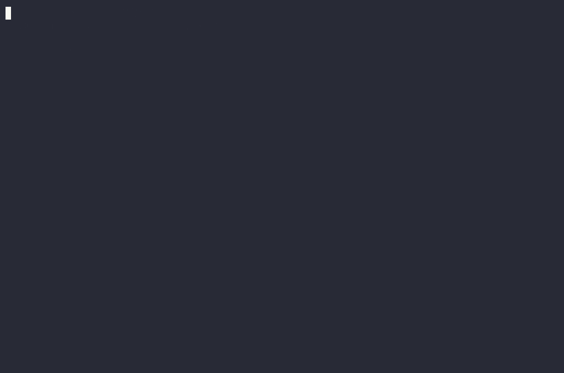
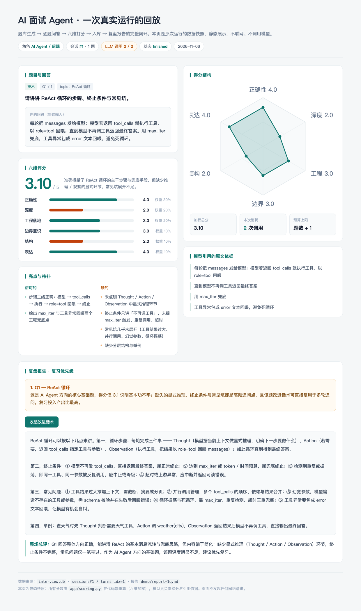
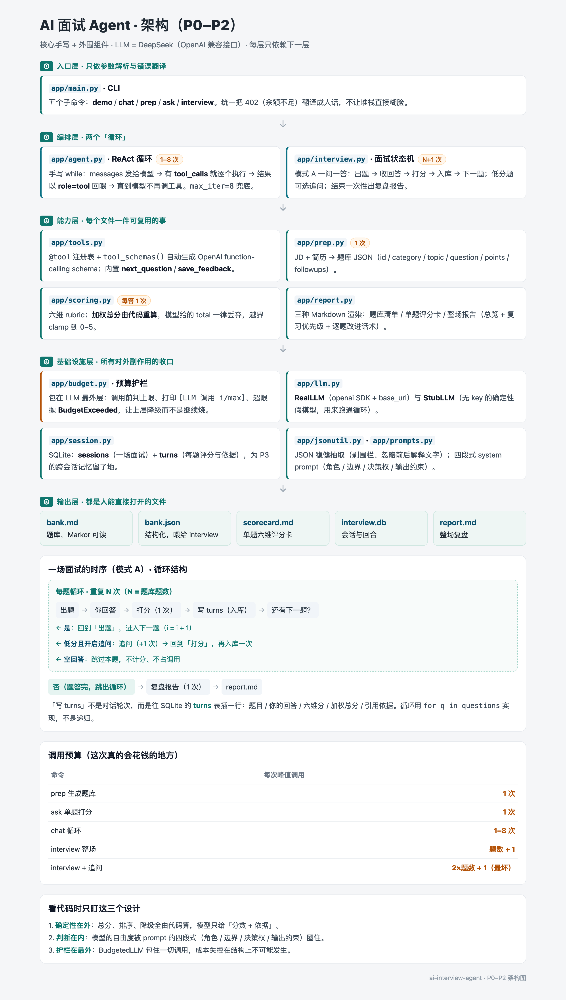

# AI 面试 Agent（ai-interview-agent）

一个**从零手写 ReAct 循环**的 AI 面试官 / 面试陪练：读 JD + 简历 → 生成对口题库 → 多轮模拟面试 → 按 rubric 打分复盘。技术路线：**核心手写 + 外围组件**，LLM 走 OpenAI 兼容接口（默认 DeepSeek）。

**在线看效果**：https://andreacmy.github.io/ai-interview-agent/

## 看一眼效果（不用装环境）



*↑ 26 秒终端实录（不是摆拍）：读 JD+简历 → 生成 10 道对口题 → 单题六维打分 → 复盘报告，全程 2 次 LLM 调用*

[](demo/index.html)

*↑ 回放页的静态封面：真实跑出来的六维评分与复盘（点图进完整页面）*



*↑ 架构图：五层结构 + 每层 LLM 调用次数 + 每题循环的时序*

- **回放页** [`demo/index.html`](demo/index.html) —— 一场真实运行的数据快照，单文件、纯静态、双击即开，也可以直接挂 GitHub Pages
- **架构图** [`demo/architecture-p0-p2.png`](demo/architecture-p0-p2.png) —— 讲的是「代码怎么搭的」：谁调谁、在哪花钱
- 上面这一页的数据来自一次**真实运行**：1 题、2 次 LLM 调用、总分 3.10，落在 `interview.db` 的 `sessions#1 / turns#1`

## 日常怎么用（三步，或换成网页点）

```bash
./practice.sh init      # 第一次：建 my/raw/ 工作区
# 把原件直接丢进 my/raw/：jd.pdf / jd.png / jd.docx / resume.pdf ...
./practice.sh prep 10   # 自动转文本 → 10 题题库（1 次调用）
./practice.sh start     # 终端一问一答（每题 1 次打分 + 结尾 1 次报告）
./practice.sh web        # 或开网页：http://127.0.0.1:8000
```

终端和网页走的是同一套逻辑（`run_interview` / `score_answer` / `session_report_markdown`），
调用次数上限也一样：**题数 + 1**。网页版多一个能力——`http://127.0.0.1:8000/?replay=1`
可以直接回放历史会话，**不消耗任何调用**。

**输入不用手打成 txt**，`prep` 会自己从 `my/raw/` 里取原件转文字：

| 原件 | 处理 |
|---|---|
| `.pdf`（简历、JD 导出） | 自动抽文字（pypdf）；扫描版 PDF 抽不出会提示走 OCR |
| `.docx` / `.txt` / `.md` | 直接读取 |
| `.png` / `.jpg`（招聘 App 截图） | 需 OCR：发给助手转写，或在「预览」里全选复制 |

多张截图按 `jd-1.png`、`jd-2.png` 命名即可。文件名必须**以 `jd` 或 `resume` 开头**，脚本靠前缀认。

跑完看这三处：

| 位置 | 是什么 |
|---|---|
| `my/report-<时间>.md` | 这场复盘：总览 / 复习优先级 / 逐题改进话术 |
| `my/interview.db` | 每场每题的原始记录，`./practice.sh stat` 看累计 |
| `my/bank.md` | 题库，Markor 里读，面试前扫一眼 |

只想练一题：`./practice.sh ask "讲讲 ReAct 循环" "你的回答"`。

`my/` 已写进 `.gitignore`，真实简历不会被提交。

## 快速开始

```bash
cd "agent-learning/ai-interview-agent"
python3 -m venv .venv && source .venv/bin/activate   # 可选
pip install -r requirements.txt

# 无 key：先用 stub 跑通循环 + 工具调度
python -m app demo

# 有 key：复制 .env.example 为 .env 填入 DEEPSEEK_API_KEY
python -m app chat "开始面试"
```

## 当前进度（P0 脚手架）

- [x] 项目骨架 + 配置（`.env`/环境变量）
- [x] LLM 客户端：`RealLLM`（DeepSeek/OpenAI 兼容）+ `StubLLM`（无 key 确定性假模型）
- [x] 工具注册表 + OpenAI function-calling schema 自动生成
- [x] 最小 ReAct 循环（tool_calls → 逐个执行 → role=tool 回喂，`max_iter` 兜底）
- [x] CLI：`demo`（stub 验证）/ `chat`（真实）

## 当前进度（P1 题库 + 单题打分 + 报告）

- [x] `app/prep.py`：JD + 简历 → 结构化题库（题目/分类/考察点/追问链），输出 Markdown + JSON
- [x] `app/scoring.py`：六维 rubric（正确性/深度/工程落地/边界意识/结构/表达）打分，**加权总分由代码重算**（不信模型给的 total），越界自动 clamp
- [x] `app/report.py`：题库清单 / 评分卡 → Markdown
- [x] `app/jsonutil.py`：稳健抽取 LLM 返回的 JSON（兼容 code fence、前后解释文字）
- [x] CLI 新增：`prep`（生成题库）/ `ask`（单题打分）
- [x] `tests/test_offline.py`：FakeLLM 离线单测 5 例全过（无需真 key）
- [x] 真实 DeepSeek 端到端验证：`prep` 生成题库、`ask` 出评分卡 均跑通

```bash
# 生成题库
python -m app prep --jd jd.txt --resume resume.txt --n 10 -o bank.md --json bank.json
# 单题打分
python -m app ask --question "讲讲 ReAct 循环" --answer "你的回答..."
```

## 当前进度（P2 完整模拟面试 + 预算护栏）

- [x] `app/session.py`：SQLite 会话/回合持久化（`sessions` + `turns` 两张表）
- [x] `app/interview.py`：模式 A 一问一答编排；低分题可选追问；结束生成复盘
- [x] `app/budget.py`：**LLM 调用硬护栏**，每次打印 `[LLM 调用 i/max]`，超限抛 `BudgetExceeded`，绝不无限调用
- [x] `app/report.py`：整场报告（总览 / 复习优先级 / 逐题改进话术），预算不足自动降级为本地确定性版
- [x] CLI：`interview`（一场完整面试）
- [x] 离线单测 8 例全过；真实端到端 1 题验证成功（恰好 2 次调用）

### LLM 调用预算（重要，控制成本）

| 命令 | 调用次数 |
|---|---|
| `prep` | 1 次（生成题库） |
| `ask` | 1 次（单题打分） |
| `interview` | 题数 + 1（每题打分 1 次 + 报告 1 次）；`--followup` 每追问再 +1 |
| `chat` | 1–8 次（循环 `max_iter=8`） |

`interview` 默认预算 = 题数+1，`--max-calls` 可手改；超预算即停并降级，不会烧钱失控。

```bash
# 一场完整模拟面试（默认预算 题数+1）
python -m app interview --bank bank.json --max-calls 12 -o report.md
```

## 与学习仓库的对应（`agent-from-scratch` 8 步 → 本项目模块）

| 仓库步骤 | 本项目 |
|---|---|
| 01 minimal-loop | `app/agent.py` 主循环 + `app/tools.py` 注册表 |
| 02 react-demos | 下一步：并行工具、链式调用、MAX_ITER |
| 03 stream-events | 下一步：流式输出"面试官正在思考" |
| 04 langgraph-skeleton | 可选：把循环画成面试状态机的图 |
| 05 harness-hooks | 下一步：打分 pre/post hook、断路器、审计记录 |
| 06 eval-harness | 下一步：用自有 30/50 题做 golden set 评测 |
| 07 mcp-tools | 下一步：把题库检索/打分做成 MCP 工具 |
| 08 memory | 下一步：跨会话记忆上次薄弱点 |

## 路线图

- [x] **P0 脚手架**：手写 ReAct 循环 + 工具调度（stub LLM 也能跑通）
- [x] **P1 MVP**：JD/简历 → 题库（1 次调用）、单题打分（1 次调用）、Markdown 报告
- [x] **P2 多轮模拟面试**：一问一答状态机、低分追问、SQLite 会话落库、`BudgetedLLM` 调用预算护栏

当前：

- [x] **P2.5 全流程验收**：10 题完整会话跑通 —— `LLM 调用 11/11`、`turns` 10 条、`sessions` 状态 `finished`、平均分 3.01，报告 157 行（本地 `my/report-full.md`，不入库）

接下来：

- [ ] **P3 检索 + 可观测**
  - [x] RAG（关键词召回）：把 `my/best-answers.md`（10 题最佳答案）解析成按题知识块，打分时召回「该讲到的要点」做覆盖度对照——输出 `covered` / `missing`，报告里逐题显示命中与漏掉的要点
    - 召回纯本地计算（中文双字 + 英文词，IDF 加权），10 题自测召回 **10/10**
    - **零额外调用**：召回只是拼进本来就要发的打分 prompt
    - 召回为空 / 低于阈值时自动退化为原行为，知识库缺失不影响面试
  - [ ] `trace.jsonl`：每次 LLM 调用与工具调用落一行，能复现「这道题为什么给这个分」
- [ ] **P4 评测 + Web**
  - [x] FastAPI 单页：浏览器里答题、看六维分、出报告，复用 `run_interview` 的同一套打分与落库逻辑；`?replay=1` 零调用回放历史会话
  - [ ] golden set：用自有 30/50 题做评测集，检查打分与人工排序的一致性（`eval/`）

收尾：

- [x] **P5 作品集包装**：架构图、运行回放页、26 秒终端实录 GIF、GitHub Pages 落地页
- [ ] **P5 收尾**：简历话术（3 条 bullet + 1 段项目描述），最后写
